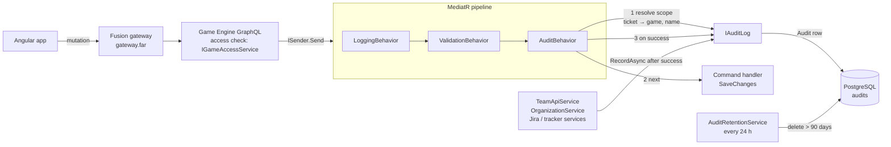
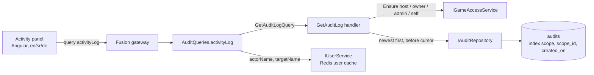

# Audit logs (activity history)

GitHub issue [#20](https://github.com/bokunda/open-planning-poker/issues/20). Hosts, team owners and
organization admins can see who changed what in the places they run: a game room, a team room and an
organization. It answers questions like "who revealed the votes early?", "who removed Marko from the room?" or
"when was this webhook deleted?".

## What is recorded

Only actions that change the shared state of a room, a team or an organization, made by someone who is allowed to
make them. Votes themselves are **not** audited (they are already stored with the ticket, and the log must not leak
hidden votes). Joining a game is not audited either: the room calls it on every visit, so it would drown the log.

| Scope | Action code | When |
|---|---|---|
| Game | `ticket.created`, `ticket.updated`, `ticket.deleted` | A ticket is added, renamed/edited or deleted (the detail keeps the ticket name, so a deleted ticket stays readable). |
| Game | `tickets.imported`, `tickets.reordered` | Tickets are imported (detail: how many) or the list is reordered. |
| Game | `ticket.estimated` | The final estimate is picked or cleared (detail: the value). |
| Game | `votes.revealed`, `votes.hidden`, `votes.reset` | The cards are turned over, hidden again for a re-vote, or the votes are cleared. |
| Game | `player.role`, `player.coHostGranted`, `player.coHostRevoked`, `player.removed`, `host.transferred` | Room roles change (the target is the player). |
| Game | `settings.deck`, `settings.options`, `settings.facilitation`, `recap.shared`, `recap.unshared`, `sorting.applied` | Deck, auto-reveal / async voting, facilitation options, recap sharing and the sorting board. |
| Team | `team.updated`, `team.memberJoined`, `team.memberLeft`, `team.memberRemoved` | Team details and membership. |
| Team | `team.anchorPinned`, `team.anchorUnpinned` | Reference tickets. |
| Team | `team.apiTokenCreated`, `team.apiTokenRevoked`, `team.webhookCreated`, `team.webhookUpdated`, `team.webhookSecretRotated`, `team.webhookDeleted` | The team's public API (tokens and webhooks; secrets are never logged). |
| Organization | `org.renamed`, `org.inviteRotated`, `org.memberJoined`, `org.memberLeft`, `org.memberRemoved`, `org.memberRole`, `org.teamAdded`, `org.teamRemoved` | Organization details, membership, roles and teams. |
| User | `integration.connected`, `integration.disconnected` | Your own Jira / GitHub / Linear / Azure DevOps connections (detail: the provider). |

## Who can read it

| Scope | Readers | Check |
|---|---|---|
| Game | The host and co-hosts | `IGameAccessService.EnsureHostAsync` |
| Team | The team owner | `IGameAccessService.EnsureTeamOwnerAsync` |
| Organization | Organization admins | `IGameAccessService.EnsureOrganizationAdminAsync` |
| User | Only that user | `scopeId == CurrentUserId` |

Everybody else gets a typed `ApplicationError` (`NotHost`, `NotTeamOwner`, `NotOrganizationAdmin`, `Forbidden`),
never an empty list, so the UI can tell "no access" from "nothing happened yet".

## Retention

Entries are kept for **90 days** (`Audit:RetentionDays`). `AuditRetentionService` (a hosted service in the Game
Engine) deletes older rows once at start-up and then every 24 hours with a single `DELETE … WHERE created_on < cutoff`.
The log stores user ids, not names: names are looked up when the log is read, and anonymous users are deleted after
24 hours, so older entries show "Someone" instead of a name. Ticket names are kept in the detail (up to 512
characters) because that is what makes the entry useful.

## Where it shows

* **Game room** — an "Activity" panel in the sidebar under the players and the chat, for the host and co-hosts.
  It loads when opened and refreshes when the room changes.
* **Team room** — an "Activity" card next to the public API settings, for the team owner.
* **Organization** — an "Activity" card on the organization page, for admins.

The list is newest first, 30 entries per page with "Show older". Texts are translated (en, sr, de); the
action code picks the sentence, so the backend never stores translated text.

## Write path



* Commands that should be audited implement `IAuditedRequest` and describe themselves with an `AuditEntry`
  (action, scope, ticket, target, detail). Nothing else has to change in their handlers.
* `AuditBehavior` resolves the entry **before** the handler runs (a ticket command only knows the ticket id; the
  behavior finds its game and name, which is gone after a delete), runs the handler, and writes the row only when
  the result is a success (`Result<T, ApplicationError>.IsSuccess`).
* Services that are not MediatR handlers (team API, organizations, integrations) call `IAuditLog.RecordAsync`
  after a successful change.
* The actor is the signed-in user (`CreatedBy`, set by the DbContext like on every entity). Changes made by the
  system (e.g. from Slack) have an empty actor and show as "Open Planning Poker".
* Writing is best effort: the change has already been saved, so a failing audit write is logged and never turns a
  successful action into an error.

## Read path



```graphql
activityLog(scope: AuditScope!, scopeId: UUID!, before: DateTime, take: Int! = 30): ActivityLogResult
# ActivityLog { entries: [ActivityEntry!]!, hasMore: Boolean! } | ApplicationError
# ActivityEntry { id action type actorId actorName ticketId targetId targetName detail createdOn }
```

Paging is a cursor on `createdOn` (`before` = the oldest entry already shown), `take` is clamped to 1–100.

## Data model

Table `audits` (it existed since the first migration but nothing wrote to it; migration `AddAuditLog` reshapes it):

| Column | Type | Notes |
|---|---|---|
| `id` | uuid | Sequential guid |
| `scope`, `scope_id` | int, uuid | Game / Team / Organization / User and its id |
| `action` | varchar(64) | Action code from the table above |
| `type` | int | Create / Update / Delete (icon in the UI) |
| `ticket_id`, `target_id` | uuid null | The ticket and the player (or team) the action was about |
| `detail` | varchar(512) null | Ticket name, deck, value, provider… never secrets or votes |
| `created_by`, `created_on` | uuid, timestamptz | Actor and time |

Index `(scope, scope_id, created_on)` serves the read query and `created_on` the retention delete.
